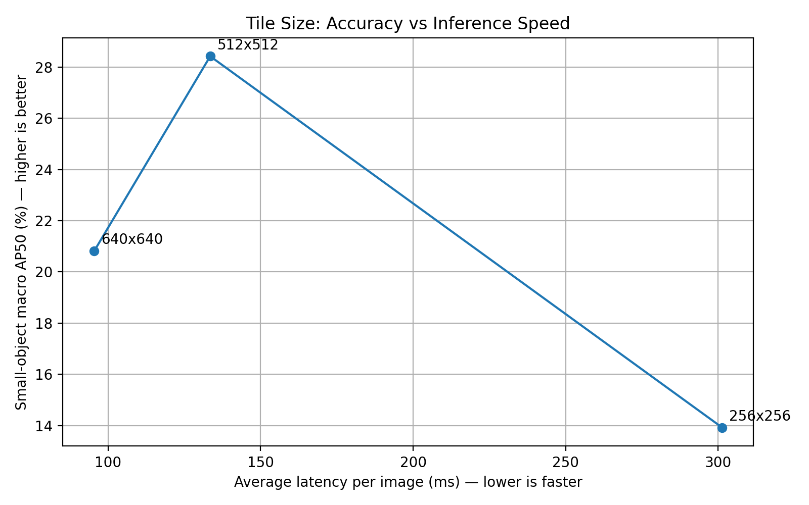

# Small Object Detection in Aerial Scenes Using YOLO and SAHI

## Project Overview

Small objects such as cars and pedestrians are difficult to detect in drone images because they occupy very few pixels. This project investigates whether sliced image inference can improve small object detection compared with standard YOLO inference.

The project uses a pretrained YOLO11n model fine-tuned on the VisDrone dataset and evaluates SAHI (Slicing Aided Hyper Inference) with different tile sizes.

## Objectives

- Train a YOLO11n object detector on VisDrone.
- Compare standard inference with SAHI sliced inference.
- Study the effect of tile size on small object detection.
- Measure the trade-off between detection performance and inference latency.
- Visualize predictions to examine objects detected by each approach.

## Technologies Used

- Python
- Google Colab and NVIDIA T4 GPU
- Ultralytics YOLO11n
- SAHI
- PyTorch
- VisDrone dataset
- Pandas, NumPy, Matplotlib, and Pillow

## Methodology

1. Set up the Google Colab environment and download the VisDrone dataset.
2. Fine-tune pretrained YOLO11n for 15 epochs at an image size of 640 pixels.
3. Evaluate standard YOLO inference and SAHI sliced inference.
4. Compare tile sizes of 256 × 256, 512 × 512, and 640 × 640 pixels.
5. Record inference latency and detections per image.
6. Evaluate small object AP50 on a 100-image validation subset using a custom evaluation script.
7. Generate side-by-side visual comparisons and performance graphs.

## Results: Tile-Size Comparison

Experiments were conducted on a subset of 100 VisDrone validation images using a fine-tuned YOLO11n model and SAHI sliced inference.

### Small-Object Detection Performance

| Method | Small-Object Macro AP50 |
|---|---:|
| Normal YOLO | 16.38% |
| SAHI with 512 × 512 tiles | 28.42% |
| Absolute improvement | +12.04 percentage points |

SAHI achieved approximately 73.5% relative improvement in custom small-object AP50 over normal YOLO on this subset.

### Effect of Tile Size

| Tile Size | Small-Object Macro AP50 | Average Latency per Image | Average Detections per Image |
|---|---:|---:|---:|
| 256 × 256 | 13.92% | 301.31 ms | 72.27 |
| 512 × 512 | 28.42% | 133.47 ms | 52.88 |
| 640 × 640 | 20.81% | 95.42 ms | 44.39 |

### Observations

- The 512 × 512 tile size achieved the highest measured small-object AP50 among the tested settings.
- The 640 × 640 tile size had the lowest measured latency.
- The 256 × 256 tile size generated the most detections but was the slowest.
- Higher detection counts do not necessarily imply higher accuracy because detections can include false positives.

### Evaluation Notes

These are preliminary results from 100 validation images using a custom small-object evaluation procedure. They are not official VisDrone benchmark metrics. The custom evaluation defines a small object as a ground-truth or predicted box with both width and height no greater than 32 pixels and uses an IoU threshold of 0.50.

SAHI may automatically change its postprocessing configuration at very low confidence thresholds. Therefore, differences in postprocessing remain a limitation when comparing SAHI with standard YOLO. Full-dataset evaluation and further checks are needed before generalizing these results.
### Key Observations

- The 512 × 512 tile setting achieved the highest measured small object AP50 among the three tested settings.
- The 640 × 640 setting had the lowest average inference latency.
- The 256 × 256 setting produced the most detections but also had the highest latency.
- More detections do not necessarily indicate better accuracy because some predictions may be false positives.

These results suggest a trade-off between detection performance and inference speed.

## Limitations

- The evaluation uses a subset of 100 validation images rather than the complete validation dataset.
- Small object AP50 is calculated using a custom evaluation script and is not directly equivalent to official VisDrone mAP.
- Results may vary with hardware, confidence thresholds, overlap settings, and postprocessing.
- Further evaluation is required before drawing conclusions about full-dataset performance.

## How to Run

The experiments were developed in Google Colab.

1. Open `Small_Object_Detection.ipynb` in Google Colab.
2. Select a GPU runtime.
3. Install the required packages, including Ultralytics and SAHI.
4. Download and prepare the VisDrone dataset.
5. Run the notebook cells in order.

The trained model checkpoint and dataset are not included in this repository.

## Future Improvements

- Evaluate on the complete validation dataset.
- Make confidence thresholds and postprocessing consistent across comparisons.
- Test additional tile sizes and overlap ratios.
- Measure memory usage and inference latency more systematically.
- Explore larger input resolutions and alternative detection models.

## Project Status

The initial model training, sliced inference experiments, tile-size comparison, and preliminary visual analysis are complete. Full validation and more rigorous evaluation remain future work.

## Three-model submission workflow

[Open the project notebook in Colab](https://colab.research.google.com/github/Ananyasaini06/Small-Object-Detection/blob/main/Small_Object_Detection.ipynb). Select **Runtime → Change runtime type → T4 GPU**. Each numbered section contains one code cell.

1. Install the detector and UI packages. Colab supplies the matched PyTorch and Torchvision builds. The first use downloads pretrained model weights.
2. Mount Google Drive. Recovery checks the project and previous run directories for best.pt or last.pt. Set `manual` to the full path of your own trusted VisDrone checkpoint if it is elsewhere. Check older folders before starting a new run.
3. Download VisDrone and prepare validation paths. Skip for a demo with saved weights.
4. With missing weights, set `TRAIN=True` to fine-tune pretrained YOLO11n for 15 epochs. Drive stores best.pt and last.pt in Small-Object-Detection/final_baseline*/weights. For an interrupted training run, select its checkpoint in section 2 and set `RESUME=True` in section 4. Resuming requires optimizer state in last.pt. Skip this section for inference with saved weights.
5. Run the comparison. It saves comparison.csv, an accuracy–speed plot, image manifest and checkpoint fingerprint to a new timestamped evaluation folder in Drive. Enable REPEAT_HISTORICAL_PROTOCOL to run the original ten-class 512-pixel comparison as well. The archived notebook preserves the other tile experiments.
6. Launch Gradio. Upload a JPG/PNG, choose a confidence threshold, then click **Compare detections**. Download each annotated PNG from its image panel. Counts and timings appear below. The temporary share URL is public while running. For a demo only, run **1 → 2 → 6**.
7. Create a dated ZIP on Drive with available checkpoints, this session’s evaluation files, installed package versions and Git revision.

### Model comparison

YOLO11n is a single-stage detector fine-tuned on VisDrone. SAHI applies the same weights to overlapping 512-pixel tiles (20% overlap), with SAHI’s default full-image pass and merging. Torchvision Faster R-CNN uses a ResNet-50 feature pyramid, region proposals and a second-stage classifier and box regressor. Its weights are COCO-pretrained, with no VisDrone fine-tuning. Differences reflect both architecture and training data.

| Configuration | Training data for detection | Historical ten-class small AP50 | Shared-class overall AP50, small AP50, latency and count |
|---|---|---:|---|
| YOLO11n | VisDrone fine-tuning | 16.38% | Generated by section 5 |
| YOLO11n + SAHI | Same checkpoint | 28.42% | Generated by section 5 |
| Faster R-CNN | COCO | — | Generated by section 5 |

The historical baseline validation was reported at approximately 27.5% mAP50 and 15.1% mAP50–95. The archived pilot_metrics.json describes a separate two-epoch pilot. Historical numbers require the original weights for exact replication.

**Shared classes.** Torchvision COCO IDs 2, 3, 8, 6 and 4 map to zero-based VisDrone IDs 2 bicycle, 3 car, 5 truck, 8 bus and 9 motor. All three methods exclude pedestrian and people (ambiguous COCO person), van, tricycle and awning-tricycle. Other COCO predictions are discarded. The demo also displays only the shared classes.

**Protocol.** Use the first 100 sorted validation JPGs, a 0.001 confidence cutoff, and the archived class-wise greedy IoU ≥ 0.5 matcher with 101-point interpolated precision. Overall includes all box sizes. Small requires width and height each ≤32 pixels for both predictions and ground truth. Macro averages include classes with ground truth. Counts use the same cutoff. Mean latency includes preprocessing, inference, postprocessing and transfer to CPU, with CUDA synchronization and one warm-up per method. Image decoding and drawing are excluded. Each model retains its native resizing and postprocessing. Demo timing uses the selected display threshold. This custom protocol differs from official VisDrone scoring.

**Historical visual evidence.** The following comparison and tile-size graph come from the corrected results archive. Section 5 creates a separate graph using your actual three-model measurements.

