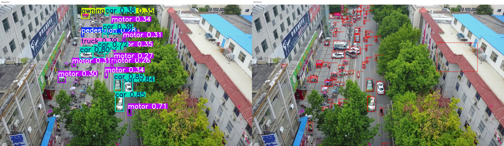

# Small-object detection in aerial scenes

A car in a drone image can occupy just a few pixels. This project asks whether running a detector on smaller crops helps it find those objects, and how much extra time that takes. The experiments use the VisDrone dataset and a Google Colab T4 GPU.

## Models and evaluation

- **YOLO11n** predicts boxes and classes in one pass over the resized image. The original experiment fine-tuned pretrained weights on VisDrone for 15 epochs at an image size of 640.
- **YOLO11n with SAHI** uses the same weights. SAHI runs the detector on overlapping tiles and merges the predictions. The tiles overlap by 20%. The 512-pixel configuration is used in the three-model comparison.
- **Faster R-CNN** first proposes regions, then classifies them and adjusts their boxes. The notebook uses Torchvision’s ResNet-50 FPN model with COCO weights. Only YOLO received VisDrone fine-tuning, so the comparison reflects training data as well as architecture.

Section 5 uses the first 100 validation JPGs sorted by filename. All three models are scored on five shared classes: bicycle, car, truck, bus and motor. COCO groups pedestrian and people under one person label and lacks direct matches for van, tricycle and awning-tricycle.

AP50 measures precision and recall with a box overlap threshold of 0.50. The small-object calculation keeps boxes at most 32 pixels wide **and** 32 pixels tall. The project averages AP across classes with ground truth. This is a custom subset evaluation. The three-model run uses a confidence threshold of 0.001 and reports overall AP50, small-object AP50, latency and detections per image. It also saves an accuracy-versus-speed plot.

## Historical ten-class results

The original baseline validation reported about 27.5% mAP50 and 15.1% mAP50–95. On the historical ten-class, 100-image small-object evaluation, full-image YOLO scored **16.38% AP50**. The 512-pixel SAHI run scored **28.42%**, a gain of 12.04 percentage points. The historical tile study measured the following results.

| Tile size | Small-object AP50 | Mean time per image | Mean detections per image |
|---|---:|---:|---:|
| 256 × 256 | 13.92% | 301.31 ms | 72.27 |
| 512 × 512 | 28.42% | 133.47 ms | 52.88 |
| 640 × 640 | 20.81% | 95.42 ms | 44.39 |

The 256-pixel tiles produced the most boxes. The 512-pixel tiles gave the highest AP50. These timings depend on hardware and inference settings. Use the new five-class CSV for a comparison with Faster R-CNN. [Historical tile measurements](final_tile_comparison.csv)




## Run in Google Colab

Select **Runtime → Change runtime type → T4 GPU**. For a demo with saved YOLO weights, run **1 → 2 → 6**. For evaluation with saved weights, run **1 → 2 → 3 → 5**. [Open the working notebook](https://colab.research.google.com/github/Ananyasaini06/Small-Object-Detection/blob/main/Small_Object_Detection.ipynb)

| Section | What to do |
|---|---|
| 1. Setup | Install the dependencies and load the project code. First use downloads pretrained weights. |
| 2. Recover weights | Mount Drive. If your trained checkpoint is elsewhere, set `manual` to its full path. |
| 3. Prepare data | Download VisDrone and locate the validation images and labels. |
| 4. Train or resume | If recovery found no usable weights, set `TRAIN=True`. To continue an interrupted Drive run, select its checkpoint in section 2 and set `RESUME=True`. Resume requires optimizer state in the original run’s last.pt. The training cell verifies best.pt and last.pt in Drive. |
| 5. Evaluate | Run the shared-class comparison. The optional switches repeat the historical protocol, full YOLO validation or tile study. Results go to a new dated folder under MyDrive/Small-Object-Detection/evaluation. |
| 6. Try an image | Upload a JPG or PNG, choose a confidence threshold and click **Compare detections**. Each panel has a download button. Counts and timings appear below. The Gradio share link is public while the demo runs. |
| 7. Back up | Save a dated ZIP to Drive with available checkpoints, this session’s results, package versions and Git revision. |

## Project files

The working notebook calls `comparison.py` for the three-model benchmark, `evaluate.py` for the original AP50 calculation, `tile_experiments.py` for the tile study and `demo.py` for Gradio. The ZIP files contain historical results and figures. The archive keeps all 55 original cells, including pilot training and saved outputs. [Original notebook](archive/Small_Object_Detection.ipynb)

## Report and live presentation

[Read the project report (PDF)](report/Small_Object_Detection_Report.pdf). Run Section 5 only to repeat the benchmark. It saves the three-model measurements and selection.txt beside the speed–accuracy graph. Selection reports the overall AP50 leader, the fastest detector and the small-object AP50 leader. Section 6 shows the latest complete comparison matching the loaded checkpoint fingerprint. Use its evidence panel for the historical training curve, epoch table, tile results and any saved training outputs alongside the checkpoint.

For the two-day submission, Faster R-CNN remains a COCO-pretrained transfer baseline. A controlled VisDrone fine-tune needs a new classification head, a separate training and validation run, and time to evaluate the resulting checkpoint. We have no measured training throughput or guaranteed T4 session for that additional experiment. The historical accuracy-first choice is SAHI 512. The completed five-class comparison is shown below. Launch the temporary Gradio link during the presentation; the runtime must remain active.

## Completed Colab run

The completed 15-epoch T4 run reported precision 39.7%, recall 30.0%, mAP50 27.5% and mAP50–95 15.1%. Its best.pt and last.pt were reported saved in MyDrive/Small-Object-Detection/final_baseline/weights.

The verified five-class evaluation used the same 100 VisDrone validation images for all three configurations. [Recorded comparison](results/verified-five-class.csv)

| Model | Overall AP50 (%) | Small-object AP50 (%) | Latency (ms/image) | Mean detections/image |
|---|---:|---:|---:|---:|
| YOLO11n | 34.2359 | 21.8370 | 14.1310 | 192.48 |
| YOLO11n + SAHI | 26.1914 | 17.4532 | 472.8199 | 215.49 |
| Faster R-CNN | 24.9709 | 23.5444 | 140.7399 | 199.85 |

**Choose YOLO11n for general use:** it has the highest overall AP50 and the lowest measured T4 latency. **Choose Faster R-CNN when small-object AP50 is the priority:** it gains 1.7074 percentage points over YOLO11n on that metric and takes about ten times as long per image. SAHI produced the most detections here, but counts alone do not measure correctness.

The historical evaluator averages across ten VisDrone classes, whereas the new evaluator averages over the five shared vehicle classes with ground truth. Both use the first 100 sorted validation JPGs, confidence 0.001, the same AP matcher and small-box limits. Both use 512-pixel SAHI slices with 20% overlap and library-default merging. Normal YOLO uses a 3000 detection cap; the SAHI wrapper uses its native cap and postprocessing. A change in the class average can reverse the ranking. Establishing the cause would require per-class scores on identical weights and software versions; the original checkpoint hash is unavailable.

## Live Demo

Open the [Colab launcher](https://colab.research.google.com/github/Ananyasaini06/Small-Object-Detection/blob/main/Small_Object_Detection.ipynb), select a T4 and run **1 → 2 → 6**. Confirm Section 2 prints the recovered Drive checkpoint. Section 1 prints the loaded Git revision. Section 6 closes older Gradio instances in this runtime, prints the revision and both live methods, loads YOLO for full-image and sliced inference and prints a new public Gradio share URL. Use that URL while the runtime is active. After a disconnect or expired link, launch again. This path skips training and evaluation.

The two live panels compare YOLO11n and YOLO11n + SAHI. Faster R-CNN remains in the recorded benchmark and Section 5 evaluation code. Its occasional zero-count live output and its measured validation AP describe different inputs and thresholds.

**Export the measured comparison:** Run updated Section 7 with Drive mounted and the checkpoint recovered. Its small github-results ZIP contains the matching benchmark files under results/<run ID>/. Extract those files for GitHub; keep weights, the full backup and VisDrone in Drive.

The Live Detection section includes three unannotated VisDrone2019-DET validation images. Select a thumbnail and click **Compare detections**. [Sample image source](https://huggingface.co/datasets/banu4prasad/VisDrone-Dataset/tree/62fc5e7387775e8f1f4fa5e027555024124763fa/VisDrone2019-DET-val/images)

### SSD MobileNetV3 candidate

Torchvision SSDLite320 MobileNetV3-Large (COCO V1) loaded and ran on the first 100 sorted VisDrone validation images. It scored **2.59% overall AP50** and **0.0461% small-object AP50**. At a 0.25 display threshold it returned at least one shared-class detection on 40 images and none on 60. At the 0.001 evaluation floor it averaged 76.57 shared detections/image. Its native SSD postprocessing and fixed 320-pixel input were used. The offline benchmark used PyTorch 2.7.1 and Torchvision 0.22.1 on CPU; its 64.36 ms/image timing cannot be ranked against the T4 times above. [SSD measurement](results/ssd-cpu.csv)

The candidate uses the same five-class mapping, box-size rule and AP matcher as the verified YOLO runs. The images and converted labels came from the VisDrone2019-DET validation mirror linked above. To repeat on the Colab dataset, run this optional command after sections 1–3 (choose a new output filename on repeat):

```python
subprocess.run([sys.executable, str(repo / "ssd_candidate.py"), str(val_dir), str(label_dir),
                str(project / "ssd-t4.csv"), "--device", "cuda"], check=True)
```

Keep YOLO11n as the primary live model and SAHI as the tiled comparison. For a future distinct architecture, a VisDrone-fine-tuned Faster R-CNN would be a better candidate to test than presenting the weak COCO SSD baseline. Its live usefulness would need separate verification.
